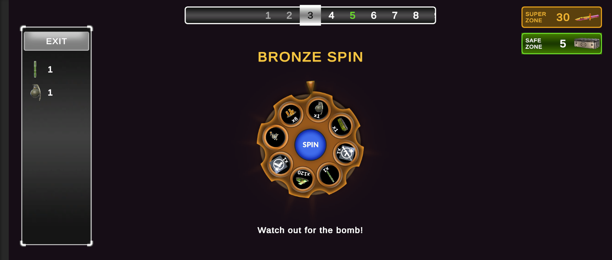
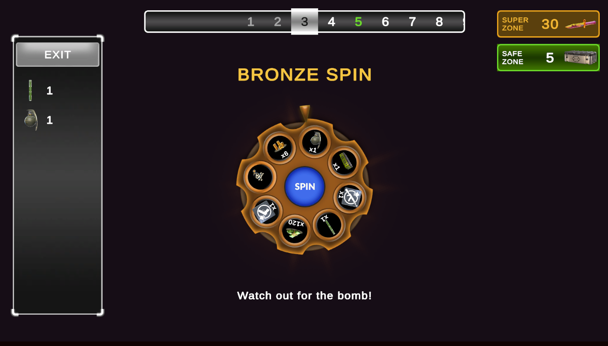
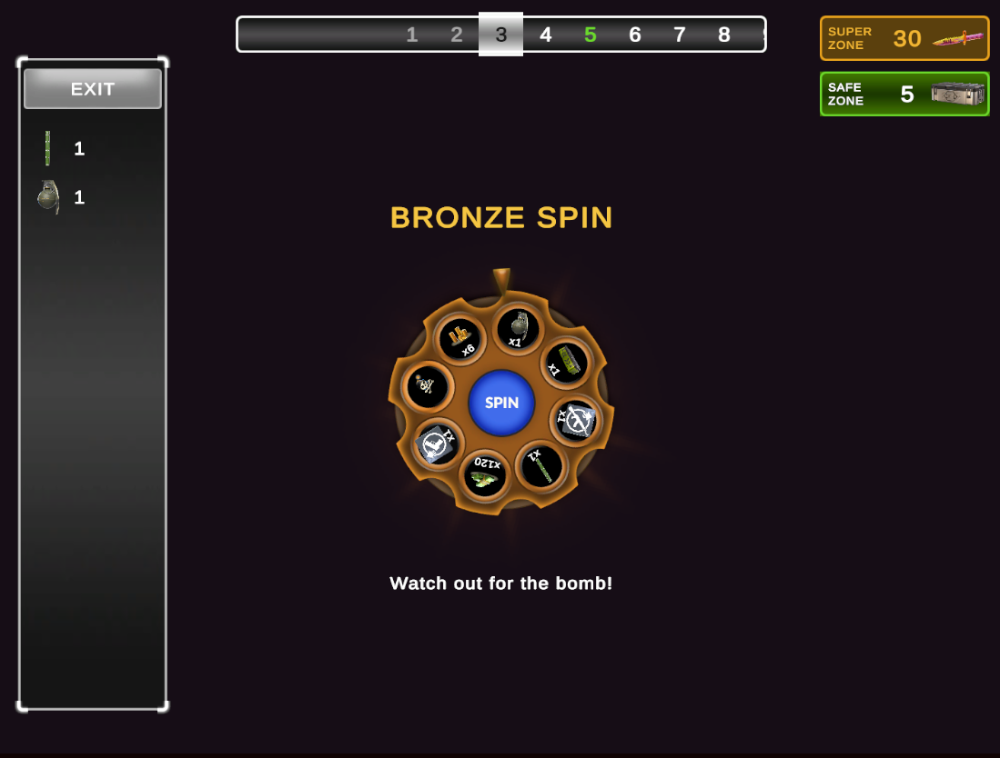

# WheelSpin Demo

Vertigo Games case project, a wheel-of-fortune version of Critical Strike's Card Game.

- **Unity:** 6000.3.23f1
- **Dependencies:** DOTween (free), TextMeshPro
- **Run:** open `Assets/_Project/Scenes/WheelGame`, or install the APK from [Releases](../../releases)

## Screenshots

| 20:9 | 16:9 | 4:3 |
|---|---|---|
|  |  |  |

## Notes

- Game logic (`GameSession`) is plain C#. It picks the spin result first; the wheel then animates to that slice. This keeps the outcome testable and independent of frame rate.
- All game rules live in the logic layer: which zones are safe, when the player may leave, the revive cost and paying it, and depositing collected currency into the wallet.
- Zone types are `ZoneTypeDefinition` assets in `Assets/_Project/Data/ZoneTypes`. Each one has an interval (every Nth zone, 0 for the default type), a safe flag and a list of wheel tiers that unlock at later zones. Adding a zone type or a wheel tier is a data change only.
- UI and logic communicate through a typed event bus (`Core/Events`). Views publish requests such as `SpinRequestedEvent`; the session publishes state changes such as `ZoneChangedEvent`; the presenter connects the two.
- Tests: Window → General → Test Runner → EditMode → Run All. `ShippedConfigurationTests` loads the real assets, so the tests check the configuration that ships.
