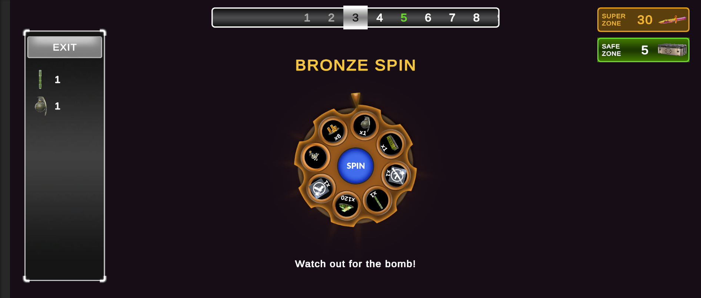
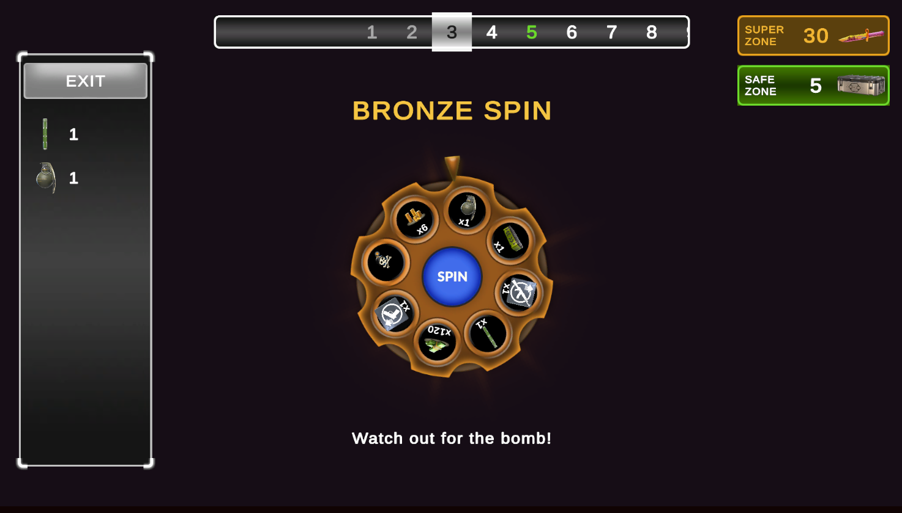
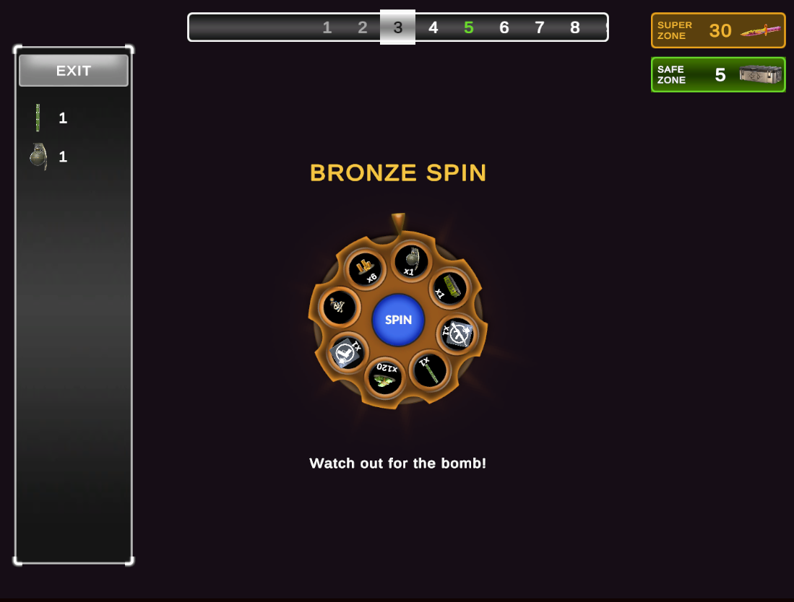

# WheelSpin Demo

Vertigo Games case project, a wheel-of-fortune version of Critical Strike's Card Game.

- **Unity:** 6000.3.23f1
- **Dependencies:** DOTween (free), TextMeshPro
- **Run:** open `Assets/_Project/Scenes/WheelGame`, or install the APK from [Releases](../../releases)

## Screenshots

| 20:9 | 16:9 | 4:3 |
|---|---|---|
|  |  |  |

## Notes

- Game logic (`GameSession`) is plain C#. It picks the spin result first; the wheel then animates to that slice. This keeps the outcome testable and independent of frame rate.
- Wheels, rewards, zone intervals and the revive cost are ScriptableObjects in `Assets/_Project/Data`, so they're all editable in the Inspector.
- Tests: Window → General → Test Runner → EditMode → Run All.
