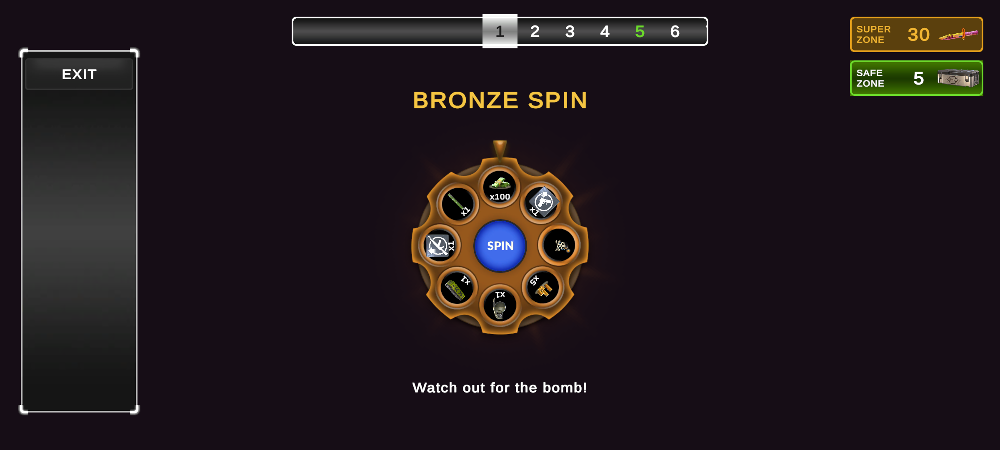
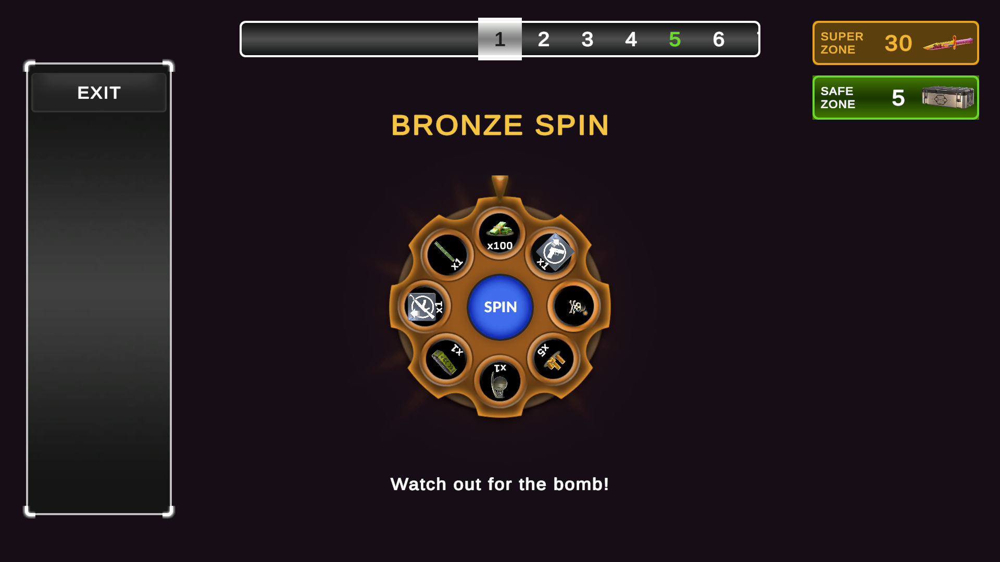
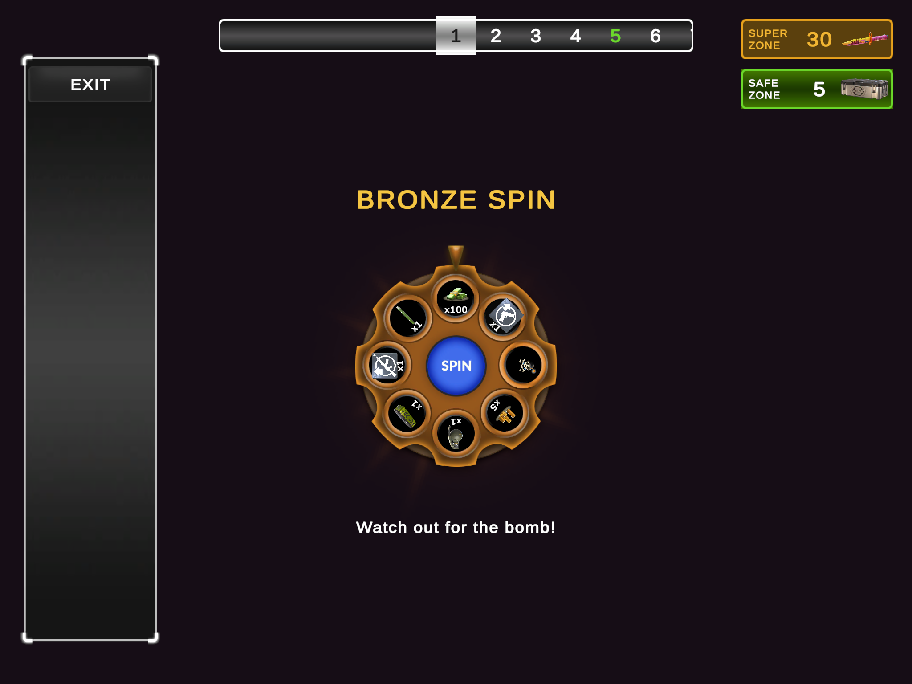

# WheelSpin Demo

Vertigo Games case project, a wheel-of-fortune version of Critical Strike's Card Game.

- **Unity:** 6000.3.23f1
- **Dependencies:** DOTween (free), TextMeshPro
- **Run:** open `Assets/_Project/Scenes/WheelGame`, or install the APK from [Releases](../../releases)
- **Tests:** Window → General → Test Runner → EditMode → Run All

## Screenshots

| 20:9 | 16:9 | 4:3 |
|---|---|---|
|  |  |  |

## Project overview

The code is split into layers, each in its own folder under `Assets/_Project/Scripts/Runtime`:

| Layer | Classes | Responsibility |
|---|---|---|
| **Data** | `RewardDefinition`, `WheelDefinition`, `ZoneTypeDefinition`, `ZoneSettings`, `EconomySettings`, `ZoneTheme` | ScriptableObjects that hold all content and tuning, edited in the Inspector. They contain only small lookups (such as which wheel tier applies to a zone) and editor validation. |
| **Gameplay** | `GameSession`, `ZoneRules`, `EconomyRules`, `RewardInventory`, `IWallet`, `IRandomProvider` | Plain C# with no MonoBehaviours. Owns every game rule: zone types, which wheel a zone uses, reward growth, leaving, bombs, revive cost and payment. |
| **Core** | `IEventBus`, `EventBus`, `IGameEvent` | A typed publish/subscribe event bus shared by the other layers. |
| **UI** | `WheelView`, `ZoneBarView`, `ZoneInfoView`, `RewardPanelView`, `RewardFlyAnimator`, popups | Passive views. They display what they are given, play DOTween animations and publish the player's requests. They contain no game rules. |
| **Presentation** | `WheelGamePresenter` | The composition root. Creates the event bus, the session and the wallet, hands them to the views, and connects session events to view updates. |

### How the systems communicate

1. A view turns a button press into a request event on the bus, e.g. `WheelView` publishes `SpinRequestedEvent`. Views never call the game logic directly.
2. `WheelGamePresenter` receives the request and asks `GameSession` to act, e.g. `TryBeginSpin`.
3. `GameSession` decides the outcome first (the slice is picked before any animation) and publishes state events such as `ZoneChangedEvent`, `SessionStateChangedEvent`, `BombHitEvent` and `RewardsCollectedEvent`. `RewardInventory` publishes `RewardAmountChangedEvent`.
4. The presenter receives those events and updates the views.
5. Animations report completion through a direct callback, not the bus. When the wheel stops, `WheelView` calls back; the presenter then plays the reward fly animation or the bomb shake, and calls `GameSession.CompleteSpin()` when that finishes. A completion callback answers one specific call, so a broadcast event would add nothing.

Because the result is chosen before the wheel animates, the outcome is testable and does not depend on frame rate.

### Content without code changes

- **Zone types** are `ZoneTypeDefinition` assets with an interval (every Nth zone; 0 marks the default type), an *Is Safe* flag (no bomb, the player may leave) and a list of wheel tiers. When several types match a zone, the largest interval wins, so zone 30 is a super zone rather than a safe zone. Adding a new zone type means creating an asset and adding it to `zone_settings`.
- **Wheel tiers** unlock better wheels at later zones. The normal wheel changes at zones 1, 6, 16 and 31, right after safe zones. Reward amounts also grow every zone.
- **Zone styles** in `ZoneTheme` are a list of zone type and style pairs, with a default style for types that have no entry.
- **Zone info boxes** in the top right are `ZoneInfoEntryView` components that each point to a zone type. Adding a box means duplicating it in the prefab.

`ShippedConfigurationTests` load the real assets and check the shipped rules: leaving only at safe and super zones, no bomb on safe wheels, a bomb on every risky wheel, and normal wheels that change as the run goes on.

## Design patterns

All five patterns below are covered in the "Must watch and learn" resources: Unity's *Level up your code with design patterns and SOLID* and the refactoring.guru catalog.

### 1. Observer: event bus

- **Where:** `IEventBus` and `EventBus` in `Core/Events`; events in `SessionEvents.cs` and `UiRequestEvents.cs`. `GameSession`, `RewardInventory` and the views publish; `WheelGamePresenter` subscribes.
- **Why:** publishers don't know who listens. `GameSession` reports that the zone changed without referencing any UI, and a view reports that Spin was pressed without referencing the session. Events are structs, so publishing does not allocate.
- **Without it:** each view would expose its own C# `event Action`, which the first version did, and the presenter would subscribe to each one by hand. Every new button meant a new event field on the view plus new wiring, and views and listeners stayed coupled by type. The alternative of the session calling views directly would put UI references inside the game logic, so the rules could not be tested without a scene.

### 2. Model-View-Presenter

- **Where:** model `GameSession`; views `WheelView`, `ZoneBarView`, `RewardPanelView`, `BombPopupView`, `CollectedPopupView` and others; presenter `WheelGamePresenter`.
- **Why:** game rules and display change for different reasons. Keeping rules in a plain C# model means they run in EditMode tests without Unity scenes, and views can be restyled without touching rules.
- **Without it:** each MonoBehaviour would hold part of the state and part of the rules. In the first version, for example, the presenter checked the gold balance and charged for the revive, outside the tested game logic. Rules spread across views are hard to find, easy to duplicate inconsistently, and cannot be unit tested.

### 3. Object Pool

- **Where:** `RewardPanelView` keeps a `Stack<RewardRowView>` of rows; `RewardFlyAnimator` reuses its flying icons; `ZoneBarView` recycles a fixed set of 15 `ZoneCellView`s and renumbers them after each shift.
- **Why:** these objects appear and disappear constantly, on every reward and every zone change. Reusing them avoids `Instantiate`/`Destroy` and garbage collection spikes, which matters on mobile.
- **Without it:** the panel would instantiate a row per reward and destroy all rows on restart, the fly animation would create and destroy five images per spin, and the zone bar would destroy and create cells every zone. That means garbage collection, possible hitches mid-animation, and more UI rebuild work.

### 4. Strategy, through interfaces

- **Where:** `IRandomProvider` (`SystemRandomProvider` in the game, `FixedRandomProvider` in tests) and `IWallet` (`PlayerPrefsWallet` in the game, `FakeWallet` in tests), injected into `GameSession`.
- **Why:** the session needs randomness and a currency store, but should not depend on how they work. Tests can force a bomb or a specific slice and control the balance.
- **Without it:** `GameSession` would call `UnityEngine.Random` and `PlayerPrefs` directly. Tests could not force an outcome, would read and write real saved data, and swapping the save system later would mean editing the game logic.

### 5. Flyweight, with ScriptableObjects

- **Where:** `RewardDefinition`, `WheelDefinition` and `ZoneTypeDefinition` assets. One `reward_gold` asset is shared by every wheel slice, reward row and flying icon that shows gold.
- **Why:** the shared, unchanging data (icon, slice layout, zone rules) is stored once. Only the per-use data lives in each object: the amount on a slice, the total in a row, the position of an icon. Editing one asset updates every place that uses it.
- **Without it:** each slice and row would carry its own copy of the icon and settings, for example as serialized fields set by hand on each prefab instance. That duplicates data in memory and in every scene or prefab file, and changing a reward's icon would mean finding and editing every copy, with a real risk of missing one.

## AI usage

- **Tool:** Claude (Anthropic), used as a chat assistant throughout the project.
- **What it was used for:**
  - planning the architecture and folder structure from the case brief
  - writing most of the C# code, the tests and an editor tool that generated the first version of the prefabs and scene, which was removed before submission
  - diagnosing Unity errors: DOTween assembly references, the Input System module, package versions when moving to Unity 6000.3.23f1
  - reviewing the code for dead code, magic numbers and inconsistent naming
  - the revision after Vertigo's feedback
- **How I reviewed and verified the output:**
  - read through every line of code to understand it and see that no systematic problems were present
  - ran every version in the Unity editor and checked the layout at 20:9, 16:9 and 4:3
  - played the build on an Android phone
  - ran the EditMode tests in the Test Runner after each change
  - when the behaviour didn't match what I saw in Critical Strike, described the problem and had it reworked. For example, the indicator first moved on its own instead of being pushed by the wheel, and the zone bar changed colour only after it stopped moving.
  - checked that the Unity UI rules in the brief were followed: naming, raycast targets, sliced sprites, anchors, and buttons connected in code

## Prompts

Prompts I wrote while working on this project:

1. > I got a demo project for vertigo games' critical strike for a job application. I'll give you the game's screenshots and the provided ui as needed. We'll make the demo, explain every line of code as we write them

2. > The first three photos are to check the different resolutions. When I press spin it truns and slows down with time, however the ticking of the indicator doesn't feel realistic, add a rigidbody to it and make the wheel literally hit it?
   > When the level is changing, the square on top of the current level and the current levels numbers change color after the correct placement is achived wihch looks bad. On the forth photo I can't press escape even though I'm on the 7th level

3. > it still looks bad towards the end when the wheel spin gets slower and I can see that it's not the edges of the wheel that's pushing the indicator but rather the indicator doing its own thing
